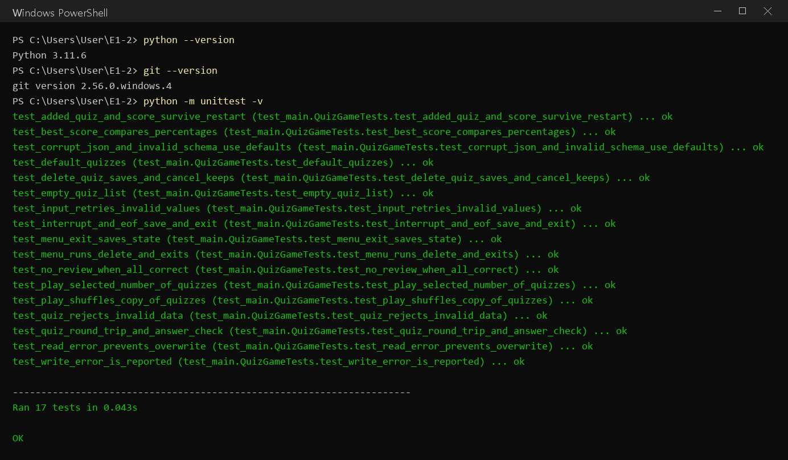
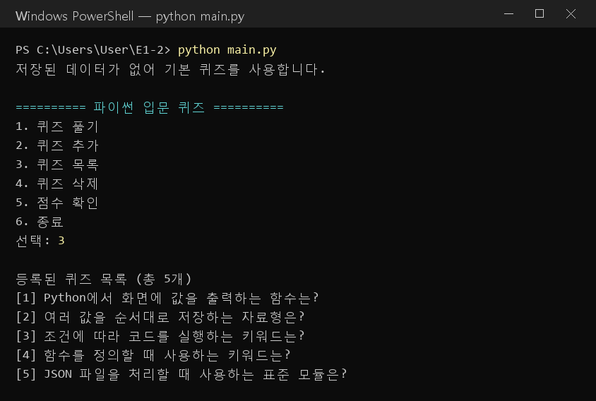
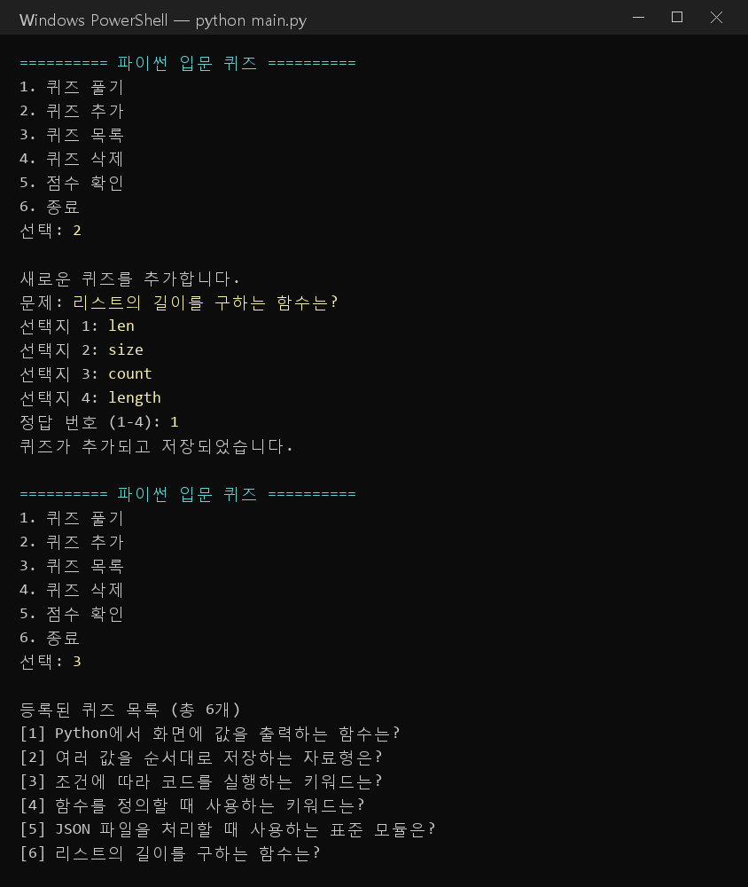
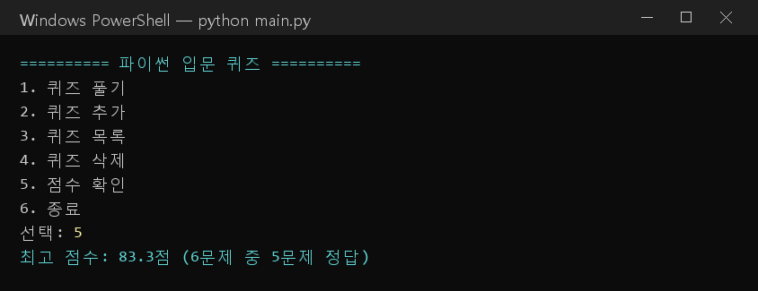
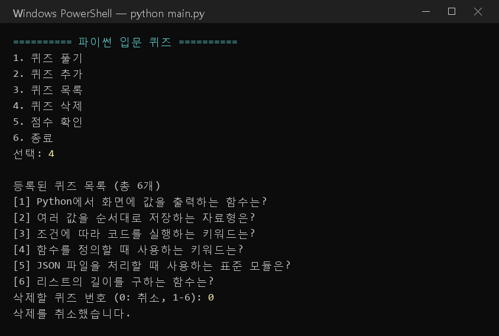
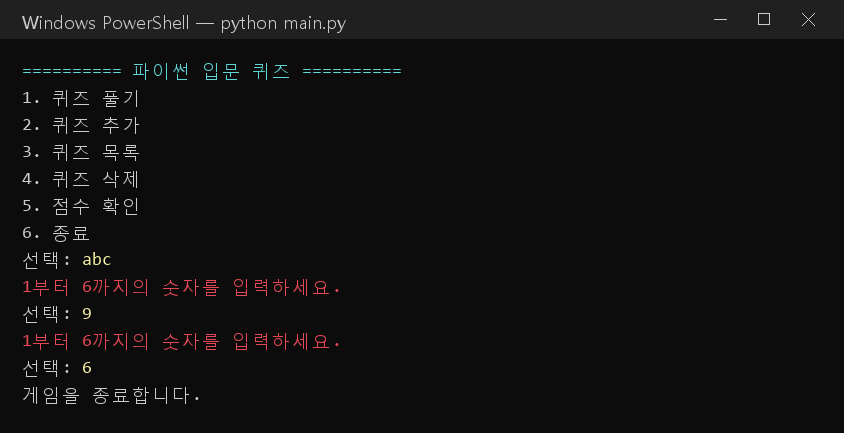
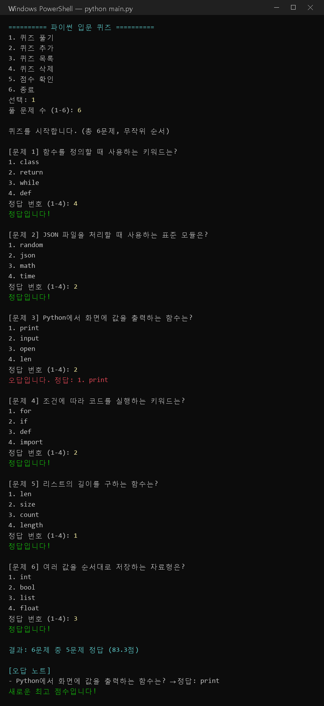
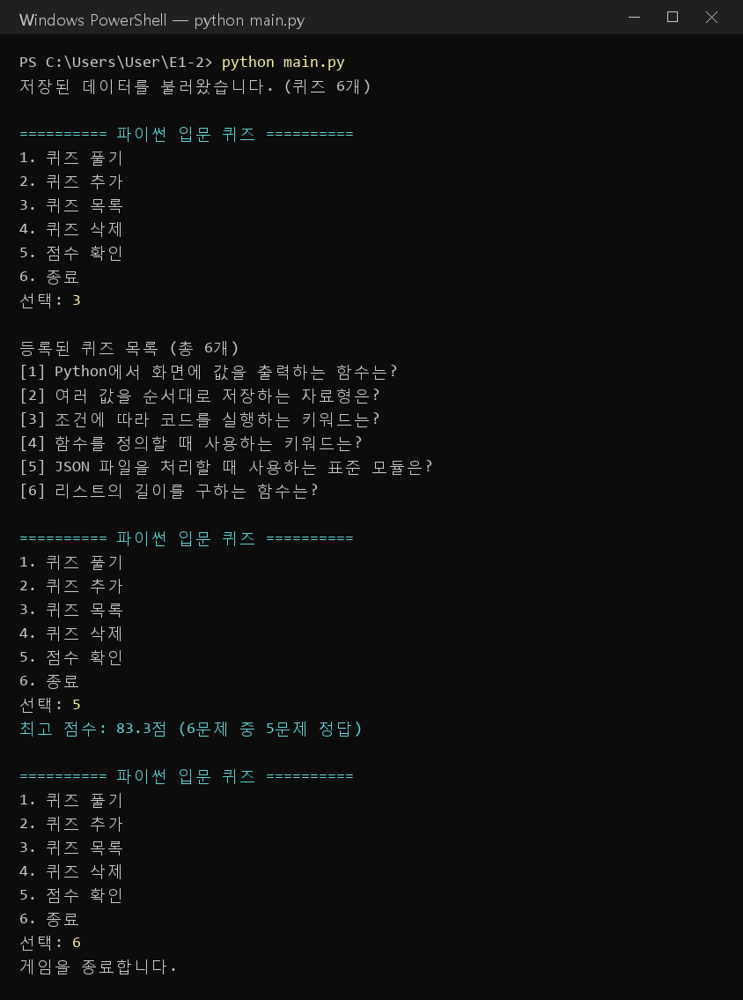
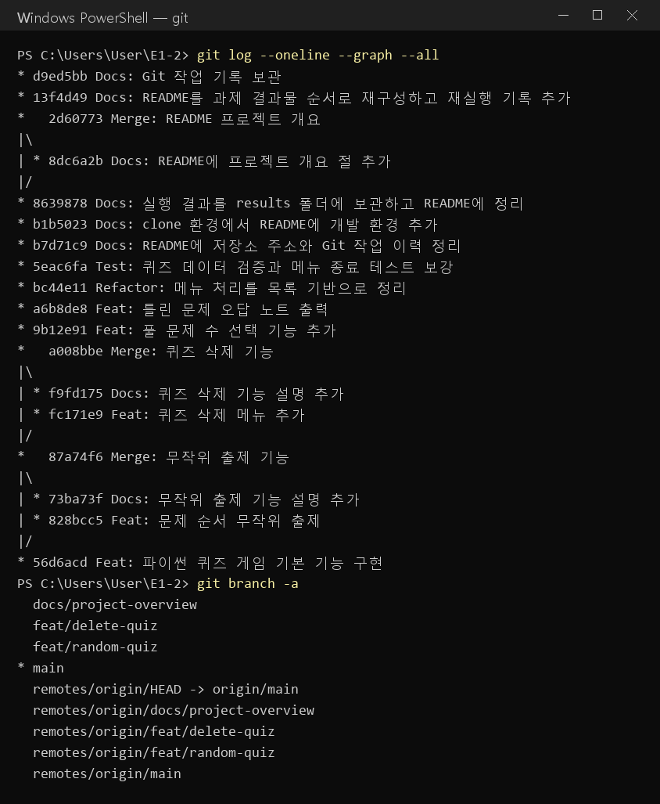
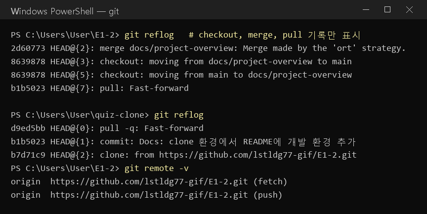

# 파이썬 입문 퀴즈

터미널에서 Python 기초 문법 퀴즈를 풀고, 직접 문제를 추가할 수 있는 콘솔 게임입니다.

- GitHub 저장소: https://github.com/lstldg77-gif/E1-2
- 실행 결과 보관 폴더: [results/](results/)

## 발표 순서

| 순서 | 내용 | 과제 요구사항 |
| --- | --- | --- |
| 1 | [프로젝트 개요](#1-프로젝트-개요) | README 필수 항목 |
| 2 | [퀴즈 주제와 선정 이유](#2-퀴즈-주제와-선정-이유) | README 필수 항목 |
| 3 | [실행 방법](#3-실행-방법) | README 필수 항목 |
| 4 | [기능 목록](#4-기능-목록) | README 필수 항목 |
| 5 | [동작하는 퀴즈 게임](#5-동작하는-퀴즈-게임) | 최종 결과물 ① |
| 6 | [코드 구조](#6-코드-구조) | 최종 결과물 ② |
| 7 | [파일 구조](#7-파일-구조) | README 필수 항목 |
| 8 | [데이터 파일 설명](#8-데이터-파일-설명-statejson) | README 필수 항목 |
| 9 | [GitHub 저장소](#9-github-저장소) | 최종 결과물 ③ |
| 10 | [요구사항 점검표](#10-요구사항-점검표) | 전체 정리 |

---

## 1. 프로젝트 개요

메뉴에서 번호를 골라 퀴즈를 풀고, 추가하고, 목록과 최고 점수를 확인하는 Python 콘솔 프로그램입니다. 추가한 문제와 최고 점수는 프로젝트 루트의 `state.json`에 저장되므로 프로그램을 껐다 켜도 그대로 남습니다.

- 메뉴: 퀴즈 풀기, 퀴즈 추가, 퀴즈 목록, 퀴즈 삭제, 점수 확인, 종료
- 구조: 문제 하나를 나타내는 `Quiz` 클래스와 게임 진행·저장을 맡는 `QuizGame` 클래스
- 외부 라이브러리 없이 Python 표준 라이브러리만 사용
- 자동 테스트 17개로 주요 기능 검증

## 2. 퀴즈 주제와 선정 이유

주제는 **Python 기초 문법**입니다. 프로그래밍을 처음 배우면서 가장 먼저 익히는 출력, 자료형, 조건문, 함수, JSON을 퀴즈로 반복해서 복습하기 위해 골랐습니다. 이 과제에서 직접 쓰는 문법이기도 해서, 퀴즈를 만들면서 내용을 다시 정리할 수 있습니다.

기본으로 들어 있는 문제는 5개입니다.

| 번호 | 문제 | 정답 |
| --- | --- | --- |
| 1 | Python에서 화면에 값을 출력하는 함수는? | print |
| 2 | 여러 값을 순서대로 저장하는 자료형은? | list |
| 3 | 조건에 따라 코드를 실행하는 키워드는? | if |
| 4 | 함수를 정의할 때 사용하는 키워드는? | def |
| 5 | JSON 파일을 처리할 때 사용하는 표준 모듈은? | json |

## 3. 실행 방법

**개발 환경**

- OS: Windows 11 Pro
- Python: 3.11.6 (3.10 이상 필요, 표준 라이브러리만 사용)
- Git: 2.56.0.windows.4
- 편집기: Visual Studio Code

**게임 실행**

```powershell
git clone https://github.com/lstldg77-gif/E1-2.git
cd E1-2
python main.py
```

메뉴에서 번호를 입력해 사용합니다. Windows에서 `python` 명령이 동작하지 않으면 `py main.py`를 사용합니다.

**자동 테스트 실행**

```powershell
python -m unittest -v
```



## 4. 기능 목록

| 메뉴 | 기능 |
| --- | --- |
| 1. 퀴즈 풀기 | 풀 문제 수를 고르면 무작위 순서로 출제합니다. 문제마다 정답 여부를 알려 주고, 끝나면 점수와 틀린 문제(오답 노트)를 보여 줍니다. |
| 2. 퀴즈 추가 | 문제, 선택지 4개, 정답 번호를 입력하면 바로 저장합니다. |
| 3. 퀴즈 목록 | 저장된 문제를 번호와 함께 보여 줍니다. |
| 4. 퀴즈 삭제 | 목록에서 번호를 골라 삭제하고 저장합니다. 0을 입력하면 취소합니다. |
| 5. 점수 확인 | 최고 점수와 그때의 정답 수, 문제 수를 보여 줍니다. |
| 6. 종료 | 데이터를 저장하고 종료합니다. |

**예외 처리**

- 숫자가 아닌 값, 범위 밖 숫자, 빈 입력은 안내 문구를 보여 주고 다시 입력받습니다.
- Ctrl+C나 입력 종료가 발생하면 안내 후 안전하게 저장하고 종료합니다.
- `state.json`이 없거나 손상되었으면 기본 문제 5개로 시작합니다.
- 파일을 읽을 수 없으면 기존 데이터를 덮어쓰지 않도록 저장을 중지합니다.

**최고 점수 기준**: 정답률로 비교합니다. 풀 문제 수가 달라도 공정하게 비교할 수 있고, 정답률이 같으면 기존 기록을 유지합니다.

---

## 5. 동작하는 퀴즈 게임

> 최종 결과물 ①: 메뉴 선택에 따른 화면 출력, 풀기/추가/목록/점수 기능, 퀴즈 5개 이상, 재실행 후 데이터 유지

실제로 `python main.py`를 실행한 기록입니다. 장면별 이미지는 [results/screenshots/](results/screenshots/), 전체 텍스트 기록은 [results/](results/) 폴더에 있습니다.

### 5-1. 메뉴 화면과 퀴즈 목록



### 5-2. 메뉴별 실행 결과 (첫 실행)

데이터 파일이 없는 상태에서 모든 메뉴를 차례로 사용했습니다. 기록: [results/run_1_first.txt](results/run_1_first.txt)

| 단계 | 입력 | 결과 |
| --- | --- | --- |
| 퀴즈 목록 | `3` | 기본 퀴즈 5개 표시 |
| 퀴즈 추가 | `2` → "리스트의 길이를 구하는 함수는?" / len, size, count, length / 정답 `1` | 저장 완료, 퀴즈 6개 |
| 퀴즈 목록 | `3` | 추가한 6번 문제 확인 |
| 퀴즈 풀기 | `1` → 풀 문제 수 `6` | 6문제 중 5문제 정답 (83.3점), 새로운 최고 점수 |
| 점수 확인 | `5` | 최고 점수 83.3점 (6문제 중 5문제 정답) |
| 퀴즈 삭제 | `4` → `0` | 삭제 취소 |
| 잘못된 입력 | `abc`, `9` | "1부터 6까지의 숫자를 입력하세요." 안내 후 재입력 |
| 종료 | `6` | 데이터 저장 후 종료 |

**퀴즈 추가** (추가 후 목록에 6번 문제가 생김)



**점수 확인**



**퀴즈 삭제 (0 입력으로 취소)**



**잘못된 입력 처리와 종료**



### 5-3. 퀴즈 풀기 화면

풀 문제 수를 고르면 무작위 순서로 출제하고, 끝나면 점수와 오답 노트를 보여 줍니다.



### 5-4. 종료 후 다시 실행: 데이터 유지 확인

프로그램을 종료한 뒤 다시 실행하자, 추가한 퀴즈와 최고 점수가 그대로 불러와졌습니다. 기록: [results/run_2_restart.txt](results/run_2_restart.txt)



---

## 6. 코드 구조

> 최종 결과물 ②: 클래스 2개 이상, 기능별 메서드 분리, 프로젝트 루트 `state.json`에 UTF-8로 저장·불러오기

모든 코드는 [main.py](main.py) 한 파일에 있습니다.

### 6-1. 클래스

| 클래스 | 역할 | 메서드 |
| --- | --- | --- |
| [`Quiz`](main.py#L9) | 문제 하나 (문제, 선택지 4개, 정답 번호) | `__init__` 데이터 검증, `display` 문제 출력, `is_correct` 정답 확인, `to_dict` 저장용 변환 |
| [`QuizGame`](main.py#L64) | 게임 전체 진행과 저장 | 아래 표 참고 |

### 6-2. 기능별 메서드 분리

| 구분 | 함수/메서드 | 하는 일 |
| --- | --- | --- |
| 입력 처리 | [`read_number`](main.py#L44) | 범위 안의 숫자가 들어올 때까지 다시 입력받음 |
| 입력 처리 | [`read_text`](main.py#L56) | 빈칸이 아닌 글자가 들어올 때까지 다시 입력받음 |
| 게임 진행 | [`run`](main.py#L187) | 메뉴 출력과 선택 처리, 종료 시 저장 |
| 게임 진행 | [`play`](main.py#L113) | 문제 수 선택, 무작위 출제, 채점, 오답 노트, 최고 점수 갱신 |
| 게임 진행 | [`add_quiz`](main.py#L145) / [`list_quizzes`](main.py#L156) / [`delete_quiz`](main.py#L164) / [`show_score`](main.py#L179) | 추가 / 목록 / 삭제 / 점수 확인 |
| 저장 로직 | [`load_state`](main.py#L72) | `state.json`을 UTF-8로 읽고 형식을 검증, 문제가 있으면 기본 퀴즈 사용 |
| 저장 로직 | [`save_state`](main.py#L97) | 임시 파일에 먼저 쓴 뒤 교체해서 저장 도중 파일이 깨지지 않게 함 |
| 기본 데이터 | [`default_quizzes`](main.py#L34) | 기본 문제 5개 생성 |

### 6-3. 저장 위치

```python
STATE_FILE = Path(__file__).resolve().parent / "state.json"   # 프로젝트 루트
with self.state_file.open("r", encoding="utf-8") as file:      # 불러오기
with temporary_file.open("w", encoding="utf-8") as file:       # 저장하기
```

실행 위치와 상관없이 항상 `main.py`가 있는 프로젝트 루트의 `state.json`을 사용합니다.

## 7. 파일 구조

```text
E1-2/
├── main.py              # Quiz, QuizGame 클래스와 프로그램 시작점
├── test_main.py         # unittest 자동 테스트 17개
├── README.md            # 프로젝트 설명 (이 문서)
├── .gitignore           # 개인 데이터(state.json)와 캐시 제외
├── results/             # 실행 결과 보관
│   ├── README.md            # 실행 결과 정리
│   ├── run_1_first.txt      # 첫 실행 전체 화면 기록
│   ├── run_2_restart.txt    # 재실행 화면 기록 (데이터 유지 확인)
│   ├── state_result.json    # 실행 후 저장된 데이터 사본
│   ├── git_history.txt      # Git 커밋·브랜치·clone·pull 기록
│   └── screenshots/         # 실행 장면 이미지 10장 (01~10)
└── state.json           # 실행하면 생성되는 실제 데이터 파일 (GitHub 제외)
```

## 8. 데이터 파일 설명 (state.json)

- 위치: 프로젝트 루트의 `state.json`
- 인코딩: UTF-8 (한글이 그대로 보이도록 `ensure_ascii=False`)
- 생성 시점: 퀴즈를 추가하거나, 최고 점수가 바뀌거나, 프로그램을 종료할 때
- GitHub 업로드: 사용자마다 다른 개인 데이터라 `.gitignore`로 제외했습니다. 결과 확인용 사본은 [results/state_result.json](results/state_result.json)에 있습니다.

| 키 | 형식 | 설명 |
| --- | --- | --- |
| `quizzes` | 배열 | 저장된 문제 목록 |
| `quizzes[].question` | 문자열 | 문제 |
| `quizzes[].choices` | 문자열 4개의 배열 | 선택지 |
| `quizzes[].answer` | 1~4 정수 | 정답 번호 |
| `best_score` | 객체 또는 `null` | 최고 점수. 기록이 없으면 `null` |
| `best_score.correct` | 정수 | 맞힌 문제 수 |
| `best_score.total` | 정수 | 푼 문제 수 |

실행 후 실제로 저장된 파일의 일부입니다.

```json
{
  "quizzes": [
    {
      "question": "Python에서 화면에 값을 출력하는 함수는?",
      "choices": [
        "print",
        "input",
        "open",
        "len"
      ],
      "answer": 1
    },
    ...
    {
      "question": "리스트의 길이를 구하는 함수는?",
      "choices": [
        "len",
        "size",
        "count",
        "length"
      ],
      "answer": 1
    }
  ],
  "best_score": {
    "correct": 5,
    "total": 6
  }
}
```

---

## 9. GitHub 저장소

> 최종 결과물 ③: GitHub 업로드, 의미 있는 커밋 10개 이상, 브랜치 생성·병합, clone·pull 사용

저장소 주소: https://github.com/lstldg77-gif/E1-2

전체 기록은 [results/git_history.txt](results/git_history.txt)에 보관했습니다. 직접 확인할 때는 다음 명령을 사용합니다.

```powershell
git log --oneline --graph --all   # 커밋과 브랜치 병합 그래프
git reflog                        # checkout, merge, pull 기록
```



### 9-1. 커밋 기록

기능, 테스트, 문서를 나눠서 커밋했습니다. 커밋 메시지는 `종류: 내용` 형식입니다.

| 순서 | 커밋 메시지 | 종류 |
| --- | --- | --- |
| 1 | Feat: 파이썬 퀴즈 게임 기본 기능 구현 | 기능 |
| 2 | Feat: 문제 순서 무작위 출제 | 기능 (브랜치) |
| 3 | Docs: 무작위 출제 기능 설명 추가 | 문서 (브랜치) |
| 4 | Merge: 무작위 출제 기능 | 병합 |
| 5 | Feat: 퀴즈 삭제 메뉴 추가 | 기능 (브랜치) |
| 6 | Docs: 퀴즈 삭제 기능 설명 추가 | 문서 (브랜치) |
| 7 | Merge: 퀴즈 삭제 기능 | 병합 |
| 8 | Feat: 풀 문제 수 선택 기능 추가 | 기능 |
| 9 | Feat: 틀린 문제 오답 노트 출력 | 기능 |
| 10 | Refactor: 메뉴 처리를 목록 기반으로 정리 | 리팩터링 |
| 11 | Test: 퀴즈 데이터 검증과 메뉴 종료 테스트 보강 | 테스트 |
| 12 | Docs: README에 저장소 주소와 Git 작업 이력 정리 | 문서 |
| 13 | Docs: clone 환경에서 README에 개발 환경 추가 | 문서 (clone에서 작업) |
| 14 | Docs: 실행 결과를 results 폴더에 보관하고 README에 정리 | 문서 |
| 15 | Docs: README에 프로젝트 개요 절 추가 | 문서 (브랜치) |
| 16 | Merge: README 프로젝트 개요 | 병합 |
| 17 | Docs: README를 과제 결과물 순서로 재구성하고 재실행 기록 추가 | 문서 |
| 18 | Docs: Git 작업 기록 보관 | 문서 |
| 19 | Docs: 실행 장면 이미지 저장 | 문서 |

### 9-2. 브랜치 생성과 병합

기능마다 브랜치를 만들어 작업한 뒤 `main`으로 돌아와(checkout) `--no-ff`로 병합(merge)했습니다.

| 브랜치 | 작업 내용 | 병합 커밋 |
| --- | --- | --- |
| `feat/random-quiz` | 문제 순서 무작위 출제 | Merge: 무작위 출제 기능 |
| `feat/delete-quiz` | 퀴즈 삭제 메뉴 | Merge: 퀴즈 삭제 기능 |
| `docs/project-overview` | README 프로젝트 개요 | Merge: README 프로젝트 개요 |

```powershell
git checkout -b docs/project-overview          # 브랜치 생성
git commit -m "Docs: README에 프로젝트 개요 절 추가"
git checkout main                              # main으로 이동
git merge --no-ff docs/project-overview        # 병합
```

`git reflog` 기록:

```text
HEAD@{..}: merge docs/project-overview: Merge made by the 'ort' strategy.
HEAD@{..}: checkout: moving from docs/project-overview to main
HEAD@{..}: commit: Docs: README에 프로젝트 개요 절 추가
HEAD@{..}: checkout: moving from main to docs/project-overview
```

### 9-3. clone과 pull

다른 폴더(`quiz-clone`)에 저장소를 복제해 README를 수정하고 push한 뒤, 원래 폴더에서 pull로 받아왔습니다.

```powershell
cd ..
git clone https://github.com/lstldg77-gif/E1-2.git quiz-clone   # clone
cd quiz-clone
git add README.md
git commit -m "Docs: clone 환경에서 README에 개발 환경 추가"
git push
cd ..\E1-2
git pull                                                        # pull
```

기록:

```text
quiz-clone$ git reflog
HEAD@{1}: clone: from https://github.com/lstldg77-gif/E1-2.git

E1-2$ git reflog
HEAD@{..}: pull: Fast-forward
```



---

## 10. 요구사항 점검표

| 구분 | 요구사항 | 결과 | 근거 |
| --- | --- | --- | --- |
| 퀴즈 게임 | 메뉴 번호에 따라 출제/등록/목록/점수/종료 화면 출력 | ✅ | [5-2](#5-2-메뉴별-실행-결과-첫-실행) |
| 퀴즈 게임 | 퀴즈 풀기, 추가, 목록, 점수 확인 동작 | ✅ | [5-2](#5-2-메뉴별-실행-결과-첫-실행), 테스트 17개 통과 |
| 퀴즈 게임 | 선택한 주제의 퀴즈 5개 이상 | ✅ | [2](#2-퀴즈-주제와-선정-이유) |
| 퀴즈 게임 | 종료 후 다시 실행해도 퀴즈와 최고 점수 유지 | ✅ | [5-4](#5-4-종료-후-다시-실행-데이터-유지-확인) |
| 코드 구조 | 클래스 2개 이상 | ✅ | [6-1](#6-1-클래스) `Quiz`, `QuizGame` |
| 코드 구조 | 기능별 메서드 분리 (입력/진행/저장) | ✅ | [6-2](#6-2-기능별-메서드-분리) |
| 코드 구조 | 프로젝트 루트 `state.json`에 UTF-8로 저장·불러오기 | ✅ | [6-3](#6-3-저장-위치), [8](#8-데이터-파일-설명-statejson) |
| GitHub | 코드 업로드 | ✅ | https://github.com/lstldg77-gif/E1-2 |
| GitHub | 의미 있는 커밋 10개 이상 | ✅ | [9-1](#9-1-커밋-기록) 19개 |
| GitHub | 브랜치 생성 및 병합 1회 이상 | ✅ | [9-2](#9-2-브랜치-생성과-병합) 3회 |
| GitHub | clone, pull 각 1회 이상 | ✅ | [9-3](#9-3-clone과-pull) |
| README | 개요, 주제 선정 이유, 실행 방법, 기능 목록, 파일 구조, 데이터 파일 | ✅ | [1](#1-프로젝트-개요), [2](#2-퀴즈-주제와-선정-이유), [3](#3-실행-방법), [4](#4-기능-목록), [7](#7-파일-구조), [8](#8-데이터-파일-설명-statejson) |
